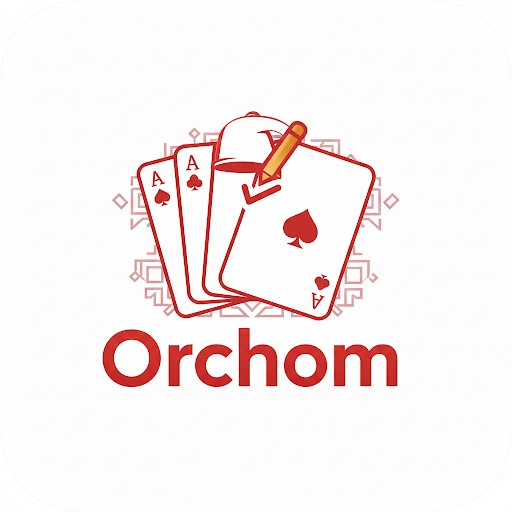

<div align="center">



# Orchom

**The score keeper for Rami Tunisien 🇹🇳** — stop counting on paper, start tracking on your phone.

*A paper-free score book for the Tunisian Rami (Rummy) card game.*

[](LICENSE)
[](https://flutter.dev)
[](https://en.wikipedia.org/wiki/Rummy)

</div>

---

## 📖 About

**Orchom** is an open source Android/desktop app built with Flutter that acts as a digital score book for **Rami Tunisien** — the Tunisian version of Rummy. Gone are the times of losing the paper sheet between rounds: Orchom keeps track of every player, every round, and every *"ghalta"* 😉.

Each round of real gaming, players accumulate points for year-round, family-fun during the long winter evenings. Orchom takes care of recording and adding the individual scores per round, applying penalties, announcing the moment the target score is reached (the loser has been determined!), and keeping a history of all games played.

## ✨ Features

| | |
|---|---|
| 👥 **2 or 4 players** | Classic 2-player duels or 4-player matches, with named players and optional photo avatars |
| 🎯 **Target score** | Configure a target score; the game automatically detects when a player reaches it and crowns the loser 🎉 |
| ⚠️ **Ghalta penalty** | Built-in penalty score for the classic Tunisian *ghalta* mistake, fully configurable |
| ⚡ **Quick score buttons** | One-tap buttons for common scores (e.g. `Kmalt −10`, `Frach wahdou −50`, `Ghalta +50`) — customizable, and each one can play a fun sound |
| 🔊 **Fun sound effects** | A collection of Tunisian meme sounds that fire when quick buttons are pressed |
| 🎲 **Starter modes** | Choose who starts each round: rotate in turn, random pick, or manual selection |
| ↩️ **Undo** | Mistyped a round? Undo the last round at any time |
| 🏆 **Results & ranking** | Live ranking during the game and a final results screen with winner and loser |
| 📜 **Game history** | Every finished game is stored locally (SQLite) so you can relive (or dread) past defeats |
| 🌗 **Light / dark / system theme** | A polished dark mode for long nights of playing |
| 🌍 **Bilingual** | Full localization in **English** and **Arabic** |

## 🧰 Tech stack

- **Flutter / Dart** — cross-platform UI
- **sqflite** *(+ `sqflite_common_ffi` on desktop)* — local SQLite database
- **Provider-style `ChangeNotifier` controllers** — simple state management
- **audioplayers** — quick-button sound effects
- **image_picker / flutter_image_compress / image** — player photo capture & compression
- **google_fonts** — typography
- **flutter_localizations + ARB files** — i18n (English / Arabic)

## 📱 Supported platforms

| Android | iOS | Windows | Linux | macOS | Web |
|:---:|:---:|:---:|:---:|:---:|:---:|
| ✅ | ✅ | ✅ | ✅ | ✅ | ❌ |

> Web is not supported because the app relies on a local SQLite database and native file storage.

## 🚀 Getting started

### Prerequisites

- [Flutter SDK](https://docs.flutter.dev/get-started/install) (stable channel — Dart SDK `^3.12.1`)
- For Linux desktop: the usual GTK/CMake build tools (`libgtk-3-dev`, `libmpv-dev` are **not** required for the Flutter runner itself)
- For Android: [Android Studio](https://developer.android.com/studio) (or just the SDK + command-line tools)

Check that Flutter is correctly installed:

```bash
flutter doctor
```

### Installation

```bash
# 1. Clone the repository
git clone https://github.com/YOUR_USERNAME/orchom.git
cd orchom

# 2. Fetch the dependencies
flutter pub get
```

### Run in debug mode

```bash
# Run on a connected device or emulator
flutter run

# Or target a specific platform
flutter run -d <device_id>   # see available devices with `flutter devices`
```

Run `flutter devices` and list them to find your device id.

## 🏗️ Build a release

```bash
# Android APK (installable on any Android device)
flutter build apk --release
# → build/app/outputs/flutter-apk/app-release.apk

# Android App Bundle (for Play Store)
flutter build appbundle --release

# Windows desktop app
flutter build windows --release

# Linux desktop app
flutter build linux --release

# macOS
flutter build macos --release
```

## 🧪 Running tests & analysis

The project ships with unit tests for the domain, data, and application layers:

```bash
# Static analysis
flutter analyze

# Full test suite
flutter test

# Test coverage
flutter test --coverage
```

Every push and pull request is checked by a GitHub Actions workflow that runs `flutter analyze` and `flutter test` (`.github/workflows/ci.yml`).

## 🗂️ Project structure

The codebase follows a **clean, layered architecture**:

```
orchom/
├── assets/                  # Images and sound effects
│   ├── images/              # Logo and static images
│   └── sounds/              # Quick-button sound samples
├── lib/
│   ├── main.dart            # App entry point & dependency wiring
│   ├── application/         # App-layer controllers (ChangeNotifier)
│   │   ├── game_controller.dart
│   │   ├── game_settings_controller.dart
│   │   └── theme_controller.dart
│   ├── domain/              # Pure business logic — no Flutter imports
│   │   ├── entities/        # Player, GameSession, GameConfig, …
│   │   ├── enums/           # StarterMode, AppThemeMode
│   │   ├── repositories/    # Abstract repository interfaces
│   │   └── services/        # GameEngine (rounds, scoring, winner…)
│   ├── data/                # Implementations of domain contracts
│   │   ├── local/           # SQLite database, media & audio services
│   │   └── repositories/    # GameRepositoryImpl, SettingsRepositoryImpl
│   ├── l10n/                # Localization: app_en.arb, app_ar.arb
│   │   └── generated/       # Generated AppLocalizations classes
│   └── presentation/        # UI layer
│       ├── screens/         # Home, setup, game, results, history…
│       ├── theme/           # Colors, text styles, spacing, shadows
│       └── widgets/         # Reusable Orchom design-system widgets
├── test/                    # Unit tests mirroring lib/ layers
├── docs/                    # Developer documentation
│   └── ARCHITECTURE.md      # Deep dive into the architecture
└── pubspec.yaml             # Package & asset configuration
```

**The dependency flow is strictly one-directional:** `presentation → application → domain ← data`. The domain layer is pure Dart and fully unit-testable without a device — see [docs/ARCHITECTURE.md](docs/ARCHITECTURE.md) for the deep dive.

## 🌍 Localization

Orchom speaks **English** and **Arabic** out of the box. Translations live in ARB files:

```
lib/l10n/
├── app_en.arb
└── app_ar.arb
```

Adding a new language: copy `app_en.arb` to `app_xx.arb`, translate the values, then regenerate the localization classes (automatic on `flutter run` / `flutter build` thanks to `flutter: generate: true`, or manually with `flutter gen-l10n`).

## 🗺️ Roadmap

- [ ] Export / share game results as an image
- [ ] Statistics across game history (best streaks, most *ghaltas*…)
- [ ] Sound library overhaul & mute toggle per button
- [ ] In-app renaming of historical players

Have an idea? [Open an issue](../../issues) or a pull request — see [CONTRIBUTING.md](CONTRIBUTING.md).

## 🤝 Contributing

Contributions are **welcome and much appreciated**! Whether it's a bug report, a new feature, a translation into your language, or a doc fix — please read the [contributing guidelines](CONTRIBUTING.md) and our [code of conduct](CODE_OF_CONDUCT.md) first.

## 📄 License

This project is licensed under the [MIT License](LICENSE) — meaning you are free to use, modify, and distribute it, as long as the license notice is kept.

---

<div align="center">
Made with ❤️ for Tunisian card players — good luck, and watch out for the <em>ghalta</em>! 😅
</div>
